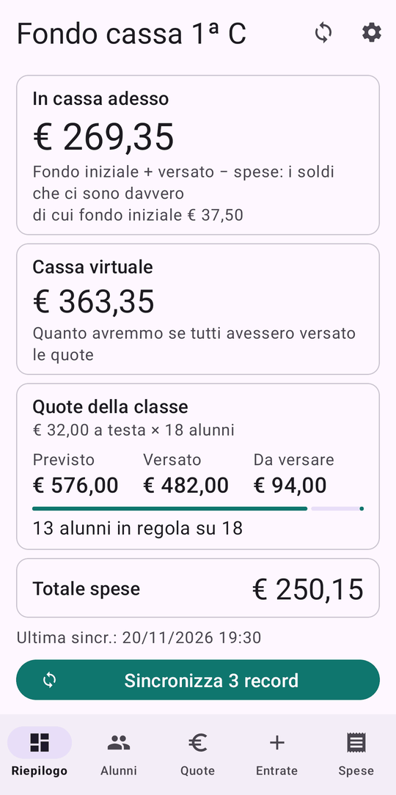
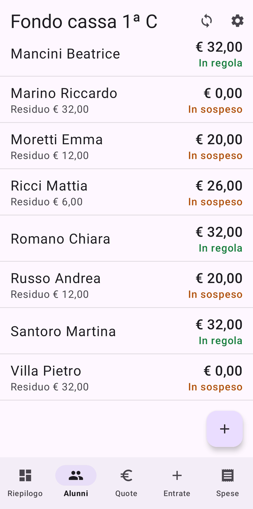
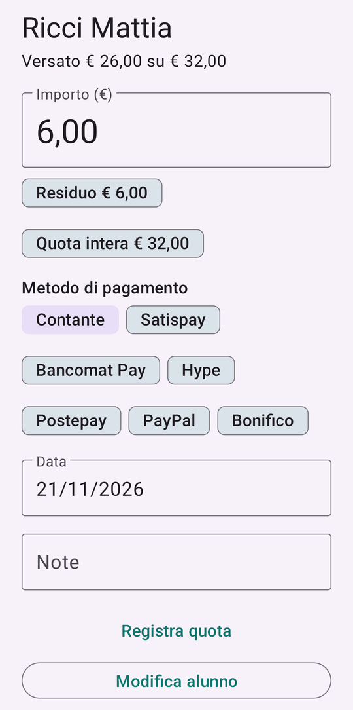
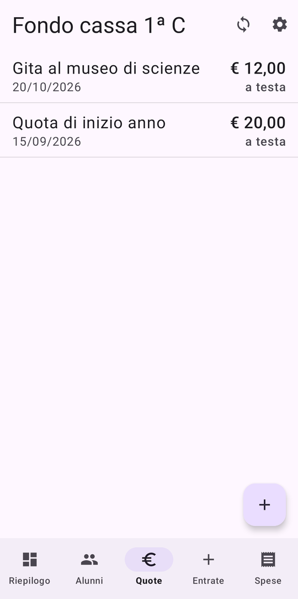
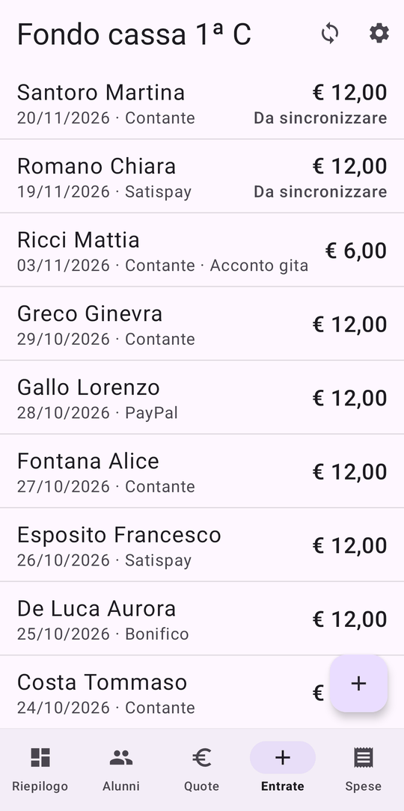
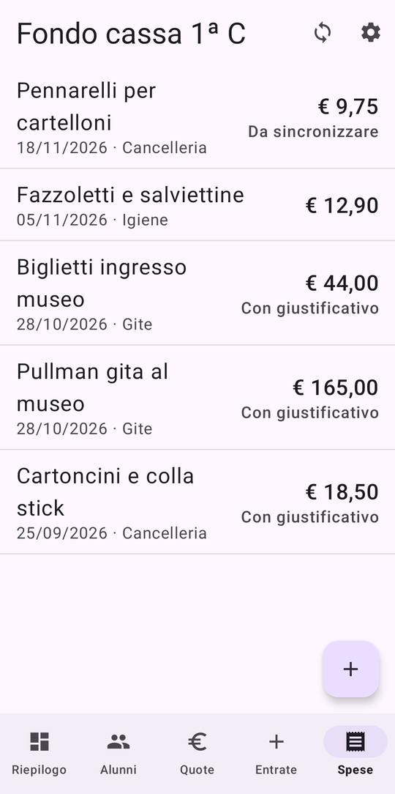
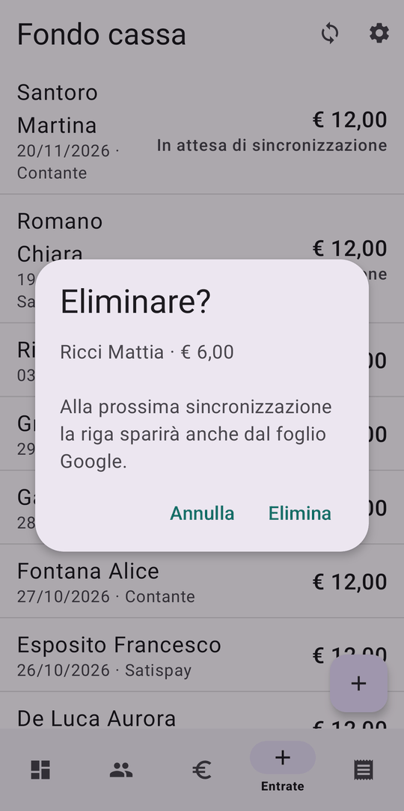
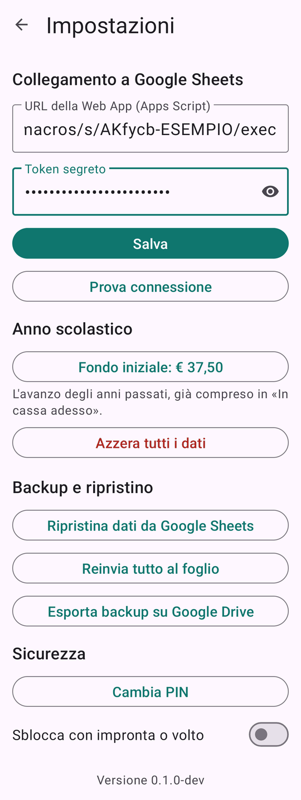

# Fondo cassa

[](https://github.com/d4niele/fondocassa/actions/workflows/ci.yml)

App Android nativa (Java) per gestire il fondo cassa di una classe: quote degli alunni, spese con
giustificativi, e un foglio Google sempre aggiornato da condividere con i genitori.

- **Offline-first**: tutto viene salvato subito in SQLite sul telefono; la sincronizzazione parte da sola quando c'è rete o con il pulsante *Sincronizza*.
- **Google Sheets come specchio e backup**: un Google Apps Script fa da ponte, senza OAuth né chiavi nell'APK. Da un telefono nuovo si ricostruisce tutto con *Ripristina dati da Google Sheets*.
- **Giustificativi su Drive**: foto dello scontrino (compressa) o PDF, caricati in una cartella dedicata e collegati alla spesa.
- **Backup completo su Drive**: uno ZIP con il database SQLite e tutti i giustificativi, con un tocco.
- **Protetta da PIN** (e biometria, se attivata).

```
[ App Android · SQLite ] ──HTTPS/JSON──► [ Apps Script · Web App ] ──► Google Sheets
                                                                  └──► Google Drive (giustificativi)
```

## Come si usa

| Scheda | A cosa serve |
|---|---|
| **Riepilogo** | *In cassa adesso* (fondo iniziale + versato − spese, con sotto «di cui fondo iniziale» se c'è un avanzo), *Cassa virtuale* (quanto ci sarebbe se tutti avessero versato), e per le quote: *Previsto*, *Versato*, *Da versare*. |
| **Alunni** | L'elenco della classe con versato, residuo e stato (*In regola* / *In sospeso*). **Un tocco su un alunno apre l'incasso rapido**: importo già compilato col residuo, metodo (Contante, Satispay, Bancomat Pay, Hype, Postepay, PayPal, Bonifico), data di oggi → *Registra quota*. |
| **Quote** | Le quote uguali per tutti, ad esempio «Quota di avvio — 5 €». Il dovuto di ogni alunno è la somma delle quote. |
| **Entrate** | Registro di tutti i versamenti. **Un tocco apre il modulo di modifica**, che in fondo ha anche *Elimina versamento*; in alternativa, **pressione prolungata** sulla riga per eliminarlo. Si chiede sempre conferma. |
| **Spese** | Uscite con categoria e giustificativo (foto o PDF). Come per le entrate: un tocco per modificare (con *Elimina spesa* in fondo), pressione prolungata per eliminare. |

Le righe eliminate spariscono subito dall'app e, alla sincronizzazione successiva, anche dal foglio Google.

<table>
  <tr>
    <td align="center"><br><sub>Riepilogo</sub></td>
    <td align="center"><br><sub>Alunni</sub></td>
    <td align="center"><br><sub>Incasso rapido</sub></td>
  </tr>
  <tr>
    <td align="center"><br><sub>Quote</sub></td>
    <td align="center"><br><sub>Entrate</sub></td>
    <td align="center"><br><sub>Spese</sub></td>
  </tr>
  <tr>
    <td align="center"><br><sub>Eliminazione con conferma</sub></td>
    <td></td>
    <td></td>
  </tr>
</table>

<sub>Nomi e importi delle schermate sono di fantasia.</sub>

### Importare l'elenco della classe

Quando la scheda *Alunni* è vuota compare il pulsante **Importa elenco da CSV o JSON**: si incolla
il testo oppure si sceglie un file. Le colonne sono `nome`, `cognome` e `note` (ad esempio i nomi
dei genitori); il separatore può essere `;`, `,` o tabulazione, e l'intestazione è facoltativa.

```csv
nome;cognome;note
Anna;Rossi;Genitori: Paola e Luca
Marco;Verdi;
```

```json
[{"nome": "Anna", "cognome": "Rossi", "note": "Genitori: Paola e Luca"},
 {"nome": "Marco", "cognome": "Verdi"}]
```

Gli alunni vengono salvati come «Cognome Nome», in ordine alfabetico come nel registro. Le note
restano nell'app e nel foglio privato: non compaiono nelle viste.

### Fondo iniziale e nuovo anno

Se la classe parte con dei soldi avanzati dagli anni passati, vai in *Impostazioni → Anno scolastico
→ Fondo iniziale* e inserisci importo, descrizione (es. «Avanzo a.s. 2025/26») e data. Il fondo si somma
alla cassa ma non al *Versato*: quote e situazione dei singoli alunni non cambiano.

A fine anno, *Impostazioni → Anno scolastico → Azzera tutti i dati* elimina quote, entrate e spese e, con l'opzione
*Riporta quanto c'è in cassa come fondo iniziale* (attiva di default), il saldo diventa il fondo
iniziale dell'anno nuovo. Prima conviene esportare un backup.

Esempio: 20 alunni, una quota di avvio di 5 € e 30 € avanzati dall'anno scorso → *Previsto* 100 €.
Se hanno versato in 12 e sono stati spesi 8 €: *Versato* 60 €, *Da versare* 40 €,
*In cassa adesso* 82 € (30 + 60 − 8), *Cassa virtuale* 122 €.

## Installazione

### 1. Foglio Google e script

Conviene usare un account Gmail dedicato alla classe (es. `fondocassa.classe@gmail.com`), così il
passaggio di consegne negli anni successivi è semplice.

Si fa una volta sola, dal browser, in una decina di minuti.

1. **Crea il foglio**: vai su <https://sheets.new> e dagli un nome (es. «Fondo cassa 3B»). Resterà **privato**: non condividerlo con nessuno.
2. **Incolla lo script**: *Estensioni → Apps Script*, cancella il codice presente e incolla il contenuto di [`apps-script/Code.gs`](apps-script/Code.gs). Salva.
3. **Esegui `setup`**: scegli la funzione **`setup`** nel menu accanto a *Esegui* e premi *Esegui*.
   - La prima volta Google chiede l'autorizzazione e mostra l'avviso «Google non ha verificato questa app»: è normale, lo script è tuo. *Avanzate → Vai a … (non sicuro) → Consenti*.
   - Lo script chiede accesso al foglio e a Drive: gli servono per scrivere i dati e salvare i giustificativi.
   - Vengono creati i fogli `Sync_*`, `Vista_Classe`, `Vista_Alunni` e `Vista_Spese`, la cartella `Fondocassa_Giustificativi` su Drive e il token segreto.
4. **Copia il token**: nel *Registro esecuzioni*, in basso, compare la riga `Token segreto da inserire nell'app: …`. È la password con cui l'app parla con lo script.
5. **Pubblica la Web App**: *Esegui il deployment → Nuovo deployment*, tipo *Applicazione web* (dall'ingranaggio), con:
   - «Esegui come: **Me**», così lo script scrive nel tuo foglio con i tuoi permessi;
   - «Chi ha accesso: **Chiunque**», perché l'app non fa login Google.

   Copia l'**URL dell'applicazione web**, quello che termina con `/exec`.

«Chiunque» significa che l'URL è raggiungibile da tutti, ma senza token lo script rifiuta ogni
richiesta: tratta il token come una password.

| Situazione | Cosa fare |
|---|---|
| Hai perso il token | Riesegui `setup`: ristampa quello esistente senza cambiarlo. |
| Il token è finito in mani sbagliate | Esegui `rigeneraToken`: quello vecchio smette subito di funzionare e va aggiornato nell'app. |
| Aggiorni `Code.gs` | *Esegui il deployment → Gestisci deployment → matita → Versione: Nuova versione*. L'URL resta lo stesso; con un *Nuovo deployment* cambierebbe. |
| *Prova connessione* dà errore HTTP o «risposta non valida» | Controlla che l'accesso sia «Chiunque» e di aver copiato l'URL che termina con `/exec`, non quello di test (`/dev`). |

### 2. App

1. Scarica l'APK dall'ultima [release](https://github.com/d4niele/fondocassa/releases) e installalo (Android 8.0 o successivo).
2. Al primo avvio scegli un PIN (almeno 4 cifre): servirà ogni volta che apri l'app.
3. Apri le *Impostazioni* (l'ingranaggio in alto a destra) e collega l'app al foglio, come spiegato qui sotto.

### 3. Impostazioni



**Classe**: facoltativa, al massimo 5 caratteri. Compare nel titolo, ad esempio «Fondo cassa 1ª C».
Basta scrivere `1C`: l'app la trasforma da sola in `1ª C`, perché la «ª» sulla tastiera del telefono
è scomoda. Viene sincronizzata con il foglio, dove compare nel titolo di `Vista_Classe`, e torna
indietro con *Ripristina dati da Google Sheets*.

**Collegamento a Google Sheets**: è l'unica parte da compilare per sincronizzare.

- **URL della Web App (Apps Script)**: l'URL copiato al punto 5 dell'installazione dello script. Inizia con `https://script.google.com/macros/s/` e **termina con `/exec`**.
- **Token segreto**: il token copiato al punto 4, dal *Registro esecuzioni*. L'occhio a destra lo mostra per controllare di averlo incollato tutto, senza spazi.
- **Salva**, poi **Prova connessione**: se compare un errore, guarda la tabella al punto 1.

Per portare URL e token sul telefono, il modo più comodo è mandarteli in un messaggio a te stesso e
copiarli da lì. Finché i due campi sono vuoti l'app funziona lo stesso, ma solo sul telefono: il
pulsante *Sincronizza* ricorda di configurarli.

**Anno scolastico**

- **Fondo iniziale**: i soldi già in cassa a inizio anno, ad esempio l'avanzo degli anni passati. Si somma a quanto versano gli alunni ed è compreso in *In cassa adesso*. Lascialo a zero se si parte da una cassa vuota.
- **Azzera tutti i dati**: da usare a inizio anno. Elimina quote, entrate, spese e fondo iniziale dal telefono e, alla sincronizzazione, anche dal foglio. Puoi tenere l'elenco degli alunni e riportare quanto c'è in cassa come nuovo fondo iniziale. Per confermare va scritto `AZZERA`. Prima conviene esportare un backup.

**Backup e ripristino**

- **Ripristina dati da Google Sheets**: su un telefono nuovo, dopo aver inserito URL e token, ricostruisce tutto dal foglio. Sostituisce i dati del telefono: se ci sono record non ancora sincronizzati l'app lo segnala, perché andrebbero persi.
- **Reinvia tutto al foglio**: se qualcuno ha cancellato o modificato a mano delle righe nel foglio, le riscrive a partire dai dati dell'app.
- **Esporta backup su Google Drive**: salva nella cartella `Fondocassa_Backup` uno ZIP con il database e tutti i giustificativi.

**Sicurezza**

- **Cambia PIN**: chiede prima quello attuale.
- **Sblocca con impronta o volto**: in alternativa al PIN, se il telefono lo supporta.

<br clear="right">

## Il foglio Google

I fogli sono correlati tra loro tramite le chiavi, come le tabelle del database dell'app:

```
Sync_Alunni   alunno_id ◄───────────┐   nome, attivo, note
Sync_Quote    id_quota              │   descrizione, importo (per alunno), data
Sync_Entrate  id_transazione, alunno_id ─┘  data, importo, metodo, note  (+ colonna «alunno» via CERCA.VERT)
Sync_Spese    id_spesa                  descrizione, categoria, data, importo, url_giustificativo ──► Drive
Sync_Fondi    id_fondo                  descrizione, importo, data  (fondo iniziale)
Sync_Impostazioni  chiave             valore  (es. classe = «1ª C»)
Vista_Classe  solo formule: il bilancio, senza dati dei singoli alunni
Vista_Alunni  solo formule: versato e quanto manca per ogni alunno
Vista_Spese   solo formule: registro delle uscite
```

- I fogli `Sync_*` sono le tabelle grezze, 1:1 con SQLite: **non vanno modificati a mano** (ogni riga ha anche `timestamp_sync`).
- Date (`gg/mm/aaaa`), importi in euro e data dell'ultima sincronizzazione sono formattati per la lettura, e le colonne hanno larghezze adatte al contenuto. I fogli creati da una versione precedente vengono riformattati da soli alla prima sincronizzazione dopo l'aggiornamento di `Code.gs`; da lì in poi le larghezze che cambi a mano restano.
- Le due viste contengono solo formule, si aggiornano da sole a ogni sincronizzazione e sono pensate per essere lette **dal telefono**: colonne strette che stanno in uno schermo in verticale, nessuna riga bloccata, niente griglia.
  - `Vista_Classe`: il titolo riporta la classe («Fondo cassa 1ª C»); in cima *In cassa adesso* e *Cassa virtuale*, poi fondo iniziale, versato, spese, da versare, quota a testa, previsto e quanti alunni sono in regola, ognuna con sotto una riga in piccolo che spiega cosa significa. Non contiene nomi né importi dei singoli alunni.
  - `Vista_Alunni`: una riga per alunno con *Versato* e *Manca* (in rosso, o ✓ se è in regola).
  - `Vista_Spese`: data, descrizione, importo e, se c'è, la scritta «Ricevuta» che apre lo scontrino, dalla spesa più recente. La scrive lo script a ogni sincronizzazione: una modifica fatta a mano in `Sync_Spese` compare qui alla sincronizzazione successiva.
- Ogni foglio ha solo le colonne che usa: quelle vuote a destra vengono eliminate (una colonna con qualcosa scritto a mano resta).
- Le colonne A:J di `Vista_Classe` sono gestite dallo script: eventuali appunti vanno scritti più a destra o in un altro foglio.

### Backup completo

*Impostazioni → Esporta backup su Google Drive* sincronizza i dati e crea, nella cartella privata
`Fondocassa_Backup`, un file `fondocassa-backup-AAAAMMGG-HHMMSS.zip` che contiene:

```
fondocassa.db            il database SQLite dell'app
giustificativi/…         tutti gli scontrini e le ricevute (jpg, png, pdf)
```

È un archivio da conservare (ad esempio a fine anno o al passaggio di consegne); il ripristino
dell'app avviene invece dai fogli `Sync_*` con *Ripristina dati da Google Sheets*.

### Condivisione con i genitori

Non condividere il foglio privato con i genitori: anche in sola lettura, chi lo apre vede tutte le
schede, comprese le note sugli alunni in `Sync_Alunni`. Condividilo solo con chi gestisce la cassa.

Le tre viste sono separate apposta, per decidere cosa mostrare a chi:

| Vista | Contiene | Come condividerla |
|---|---|---|
| `Vista_Classe` | solo il bilancio | si può pubblicare sul web |
| `Vista_Spese` | le uscite con le ricevute | si può pubblicare sul web |
| `Vista_Alunni` | nomi e importi di ogni alunno | solo a persone scelte, mai pubblicata |

**Pubblicare il bilancio e le spese.** Dal foglio privato: *File → Condividi → Pubblica sul web →
Contenuti pubblicati e impostazioni* e spunta **solo** `Vista_Classe` e `Vista_Spese`. Poi, nella
sezione *Link*, scegli `Vista_Classe` e *Pagina web*, premi *Pubblica* e copia il link: contiene
`/d/e/2PACX-…/pubhtml`. Aggiungi in fondo i parametri che tolgono numeri di riga, schede e titolo:

```
https://docs.google.com/spreadsheets/d/e/2PACX-…/pubhtml?gid=…&single=true&widget=false&headers=false&chrome=false
```

Per le spese ripeti scegliendo `Vista_Spese`. Se il link finisce con `/pubhtml`, senza `?`, il
primo parametro va attaccato con `?`. I parametri non hanno effetto sul link di modifica (`/edit`).
Dopo aver pubblicato, apri il link in una finestra in incognito e controlla che si vedano solo le
viste scelte.

Chiunque abbia il link pubblicato vede la pagina senza accedere a Google, e il link può essere
inoltrato: non c'è modo di sapere chi lo apre. La pagina si aggiorna da sola, con qualche minuto
di ritardo; per ritirarla, *Interrompi pubblicazione* nello stesso dialogo.

**Mostrare la situazione degli alunni.** Crea un **secondo foglio** e, nella cella `A1`, importa
la vista:

```
=IMPORTRANGE("URL_DEL_FOGLIO_PRIVATO"; "Vista_Alunni!A1:C")
```

La prima volta Google chiede di *Consentire l'accesso* tra i due fogli. `IMPORTRANGE` porta i
valori ma non la formattazione: seleziona le colonne `B:C` e scegli *Formato → Numero → Valuta*.
Condividi quel foglio come *Visualizzatore* con le email dei genitori: lo vedono solo loro, dopo
aver fatto l'accesso a Google, e puoi togliere l'accesso a una persona alla volta.

Google Sheets non permette di nascondere i numeri di riga nei fogli condivisi: si tolgono solo
nella pagina pubblicata.

### Sicurezza

- Ogni richiesta porta un **token segreto** verificato come prima istruzione dello script; senza token non si legge né si scrive nulla. Per cambiarlo esegui `rigeneraToken` nell'editor.
- Il traffico è solo HTTPS. Token e PIN (salvato come hash PBKDF2) stanno nella memoria privata dell'app, esclusa dai backup di Android.
- I giustificativi su Drive sono visibili in sola lettura a chi ha il link. Se l'account è Google Workspace (scuola, azienda) e vieta la condivisione pubblica, restano visibili solo nel dominio o, se nemmeno questo è permesso, solo a te.

## Sviluppo

Requisiti: JDK 21 e Android SDK (piattaforma 36). Node 22 solo per i test dello script.

```bash
./gradlew testDebugUnitTest lintDebug   # test e lint dell'app
./gradlew assembleDebug                 # APK di debug in app/build/outputs/apk/debug/
node --test apps-script/test/*.test.js  # test dello script
```

| Percorso | Contenuto |
|---|---|
| `app/src/main/java/it/fondocassa/data` | Entità e DAO Room, `Repository`, impostazioni |
| `app/src/main/java/it/fondocassa/sync` | `ApiClient` (HTTP), `SyncManager` (esporta / ripristina), `SyncWorker` (background) |
| `app/src/main/java/it/fondocassa/ui` | Activity, schede e incasso rapido |
| `app/src/main/java/it/fondocassa/util` | Importi in centesimi, `Bilancio`, compressione dei giustificativi |
| `apps-script/` | Web App Google Apps Script e relativi test |

I test dell'app girano tutti sulla JVM (JUnit + Robolectric, senza emulatore): calcoli, database,
sincronizzazione contro un server HTTP finto, PIN e le schermate principali. I test dello script
usano finti servizi Google: verificano la logica e le formule scritte, non il loro calcolo in Sheets.

### Protocollo

| Richiesta | Risposta |
|---|---|
| `GET ?action=ping&token=…` | `{ok}` |
| `GET ?action=export_all&token=…` | `{ok, alunni[], quote[], entrate[], spese[], fondi[], impostazioni[]}` |
| `POST {token, action:"sync", alunni[], quote[], entrate[], spese[], fondi[], impostazioni[]}` | `{ok, timestamp_sync, alunni[id], quote[id], entrate[id], spese[id], fondi[id], impostazioni[chiave]}` |
| `POST {token, action:"upload_giustificativo", id_spesa, filename, mime_type, data_base64}` | `{ok, url}` |
| `POST {token, action:"backup", db_base64}` | `{ok, url, nome, giustificativi}` |

Gli importi viaggiano in centesimi (`importo_cent`) e sono scritti in euro nel foglio. Un record con
`eliminato: true` viene rimosso dal foglio. In caso di errore: `{ok:false, error}`.

## Release

La CI ([`ci.yml`](.github/workflows/ci.yml)) esegue test, lint e build a ogni push e pull request.
Il workflow [`release.yml`](.github/workflows/release.yml) pubblica una release con l'APK firmato
quando viene caricato un tag di versione:

```bash
git tag v1.0.0
git push origin v1.0.0
```

Serve, una sola volta, una chiave di firma. **Conservala con cura**: per aggiornare l'app già
installata, tutte le versioni devono essere firmate con la stessa chiave.

```bash
keytool -genkeypair -v -keystore fondocassa.jks -alias fondocassa \
  -keyalg RSA -keysize 4096 -validity 10000

gh secret set KEYSTORE_BASE64 < <(base64 -w0 fondocassa.jks)
gh secret set KEYSTORE_PASSWORD
gh secret set KEY_ALIAS --body fondocassa
gh secret set KEY_PASSWORD
```

Il file `.jks` non va mai aggiunto al repository (è già in `.gitignore`).
